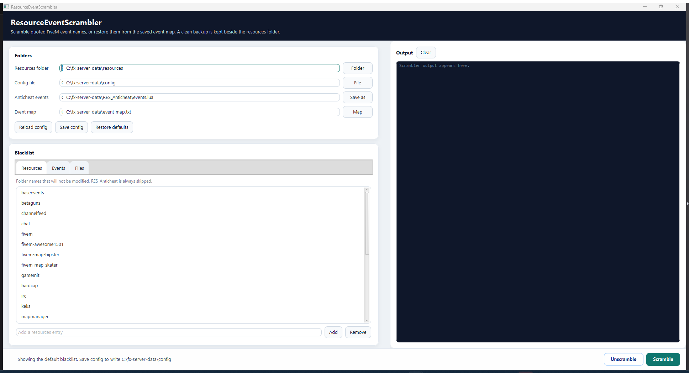
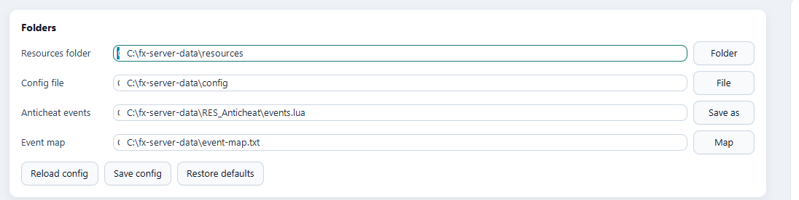
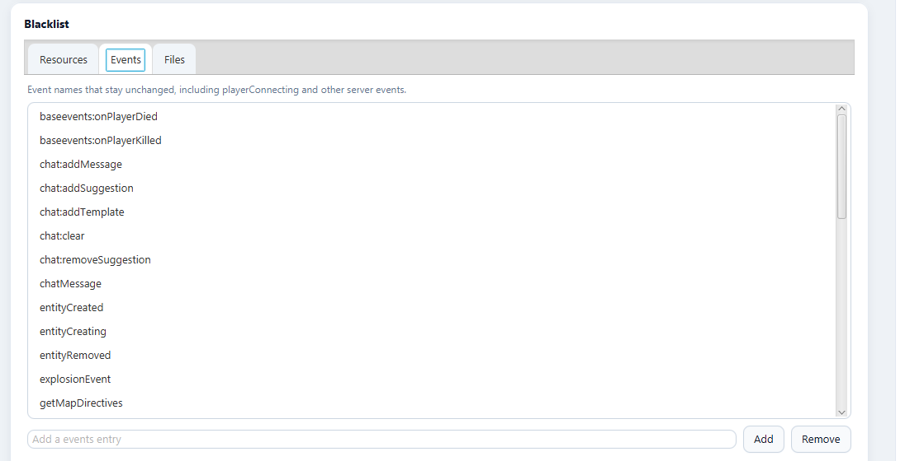
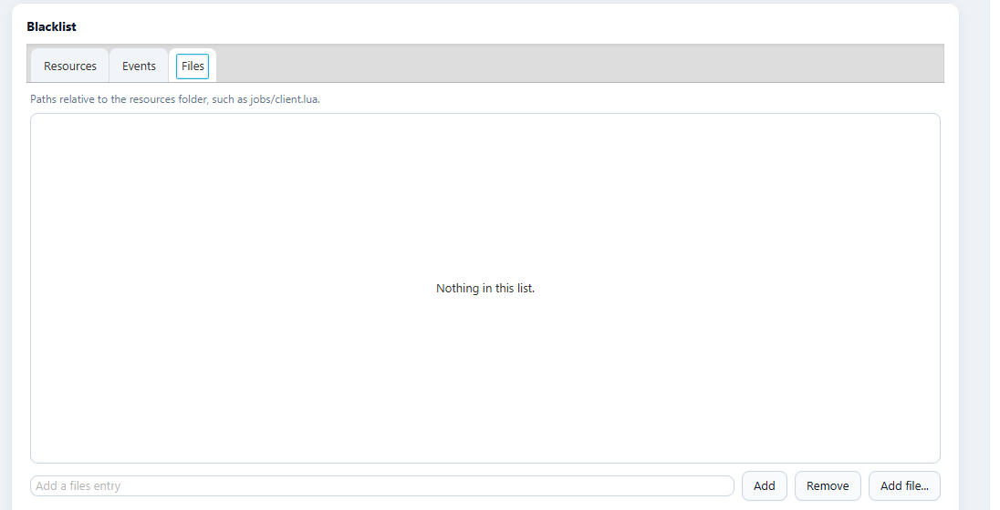

# ResourceEventScrambler

[](https://badger.store)
[](https://forthebadge.com)

[](https://github.com/JaredScar/ResourceEventScrambler/releases)

ResourceEventScrambler rewrites the event names inside a FiveM `resources` folder. A mod menu that triggers the old public names, such as `TriggerServerEvent("esx:getData")`, no longer hits anything on your server. `RES_Anticheat` then drops players who still fire those old names.

Only the quoted name inside an event call is changed. The tool does not search the rest of the file, so a short name cannot damage a longer one, a comment, or `fxmanifest.lua`.

You need Java 17 or newer (`java -version`). Put this folder in `fx-server-data`, next to `server.cfg` and `resources`, and keep a copy of `resources` somewhere else before the first run.

## 1. Open the window

Double-click `run.bat`, or from this folder run `gradlew.bat run`.



On a wide screen the window looks like the picture above.

- **Folders**, top left, is where the tool reads and writes.
- **Blacklist**, bottom left, is the list of resources, events, and files that keep their current names. The **Resources** tab is open in this picture. `chat`, `mysql-async`, and the other default entries are skipped. `RES_Anticheat` is always skipped, even if you remove it from the list.
- **Output**, on the right, is the log. After a scramble it prints every old name and the new name that replaced it.
- **Unscramble** and **Scramble** are at the bottom right. Scramble is the green button.

On a narrower window the log stacks under the blacklist instead of sitting beside it.

## 2. Set the four paths



These four rows default to the folder you launched from. Point them at your server if that folder is somewhere else. **Folder**, **File**, **Save as**, and **Map** open a picker.

| Row | Point it at | What a run does with it |
| --- | --- | --- |
| Resources folder | The live `resources` directory | Scramble rewrites files in here. |
| Config file | The `config` file next to this tool | Holds the blacklist. |
| Anticheat events | `RES_Anticheat/events.lua` | Scramble fills this with the original event names. |
| Event map | `event-map.txt`, beside the resources folder | Scramble writes it. Unscramble reads it. Keep this file. |

**Reload config** reads the config file back into the lists. **Save config** writes the lists to that file. **Restore defaults** loads the built-in blacklist into the window only. Click **Save config** if you want those defaults written to disk.

The status line along the bottom tells you whether the lists came from the file or from the built-in defaults.

## 3. Choose what must keep its name

Anything you leave off these lists can be renamed. Add a name in the box at the bottom and click **Add**, or press Enter. Select rows and click **Remove** to take them off.

### Resources

The **Resources** tab, visible in the first picture, is whole resource folders. `chat`, `spawnmanager`, `mysql-async`, and the other stock resources are already listed. Add your own when a resource must stay readable, for example a phone or a loading screen you do not want touched.

### Events



The **Events** tab is individual event names. These stay spelled the same way in every file, because FiveM and other resources call them by that exact name. The default list covers connection, chat, and entity events such as `playerConnecting`, `playerDropped`, `chat:addMessage`, and `entityCreating`. Add any custom event that outside scripts must still be able to trigger.

### Files



The **Files** tab is single files inside the resources folder. A path looks like `jobs/client.lua`, with no leading slash. **Add file...** only accepts a file from the resources folder you chose above. Leave this list empty when every non-blacklisted file may be rewritten.

The same three lists live in the `config` file. Lines starting with `#` are comments. The section headings are `Blacklisted Resources:`, `Blacklisted Events:`, and `Blacklisted Files:`.

## 4. Scramble

Click the green **Scramble** button. This dialog appears before anything is written:

![The Scramble confirmation. OK copies resources to resources [UNSCRAMBLED], rewrites the quoted event names, and writes event-map.txt.](docs/images/scramble-confirm.png)

Read the path in the question. **Cancel** leaves every file alone. **OK** does three things:

1. Copies the resources folder to `resources [UNSCRAMBLED]` beside it. That copy is the clean original. If that folder already exists, the scramble stops and nothing is changed, so a second run cannot rename names that are already scrambled.
2. Rewrites the quoted event names in the live resources folder and writes `event-map.txt`.
3. Fills `RES_Anticheat/events.lua` with the original names, which is the list the anticheat watches.

The log then prints lines like `'esx:getData' -> 'AbCdEfGhIjKl'`. When it finishes, copy `RES_Anticheat` into the scrambled `resources` folder and start it from `server.cfg`:

```
ensure RES_Anticheat
```

In `RES_Anticheat/config.lua`, `Ban = true` stores the player and refuses a later reconnect. `Ban = false` still drops them, and the ban is not saved. `Webhook` is a Discord webhook URL. Leave it as `""` to skip Discord.

A ban matches any saved identifier: `license`, `license2`, `steam`, `discord`, or `ip`. `banlist.json` stays on the server. It is not shipped to clients.

## 5. Unscramble, or add a resource later

**Unscramble** puts the original quoted names back, using `event-map.txt`. When files change, it clears the anticheat event list so those restored names are not banned. The `resources [UNSCRAMBLED]` folder stays where it is.

If `event-map.txt` is missing, copy `resources [UNSCRAMBLED]` back over `resources` instead.

A new resource dropped into an already scrambled folder will not match the current map. To add one:

1. Click **Unscramble**.
2. Add the resource to the live resources folder.
3. Delete `resources [UNSCRAMBLED]`. It is the old backup, and it blocks another scramble.
4. Click **Scramble** again. That writes a new backup and a new `event-map.txt`.

## What gets a new name

Quoted arguments of `AddEventHandler`, `RegisterNetEvent`, `RegisterServerEvent`, `TriggerEvent`, `TriggerServerEvent`, `TriggerClientEvent`, and the latent client and server triggers.

Also NUI callbacks (`RegisterNUICallback` and the `RegisterNuiCallback` spellings) and a matching `https://.../callback` address. JavaScript `on`, `emit`, `onNet`, and `emitNet`. ESX, QBCore, and `ox_lib` callback helpers.

These stay as they are:

- Blacklisted resources, events, and files, plus `RES_Anticheat`, `node_modules`, `.git`, and `.svn`.
- Comments, and any text that is not the quoted argument of one of those calls.
- A name that only lives in a variable, such as `local e = "esx:getData"` followed by `TriggerEvent(e)`.
- Browser events such as `on("click")`. Inside `dist`, `build`, and minified JavaScript, only `onNet` and `emitNet` are changed.

## Command line

The window is the normal way to run it. From a terminal, paths are relative to the folder you launch from:

```bat
gradlew.bat run --args="--cli resources config RES_Anticheat/events.lua"
gradlew.bat run --args="--unscramble resources config RES_Anticheat/events.lua event-map.txt"
```

`--cli` scrambles. `--unscramble` restores names from the event map. Leave off the later arguments to use those defaults.

## Download

**Source code:** https://github.com/JaredScar/ResourceEventScrambler

**Releases:** https://github.com/JaredScar/ResourceEventScrambler/releases
