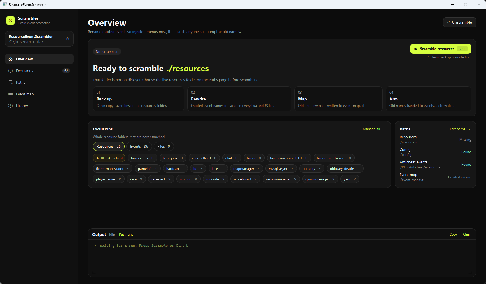
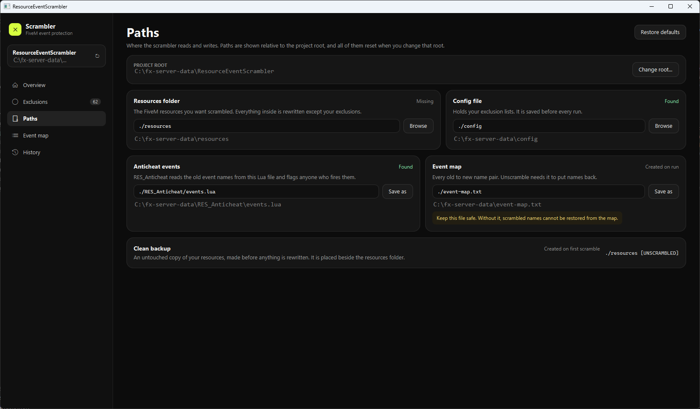
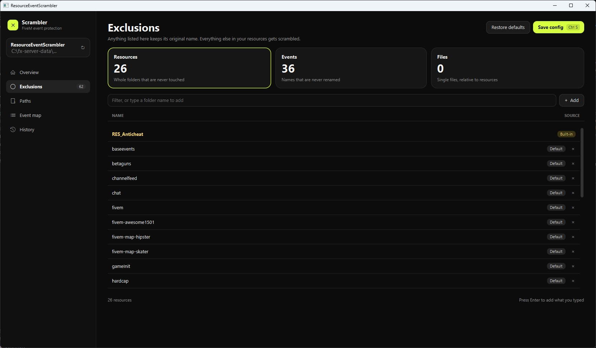
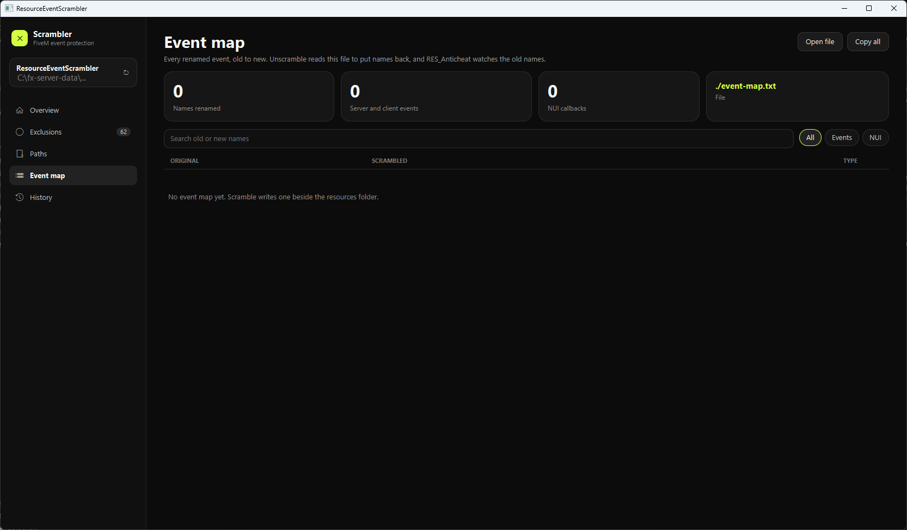
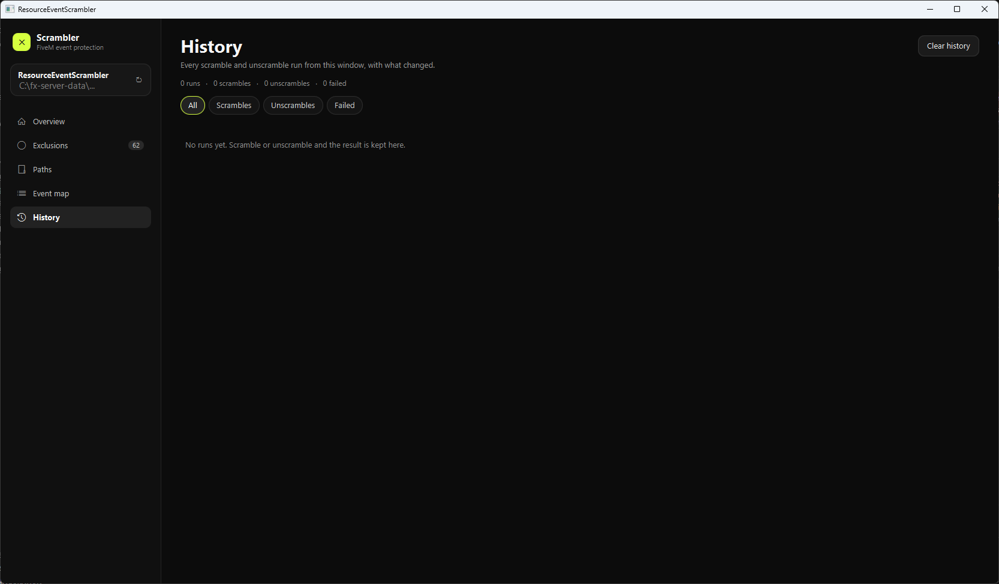

# ResourceEventScrambler

[](https://badger.store)
[](https://forthebadge.com)

[](https://github.com/JaredScar/ResourceEventScrambler/releases)

ResourceEventScrambler rewrites the event names inside a FiveM `resources` folder. A mod menu that triggers the old public names, such as `TriggerServerEvent("esx:getData")`, no longer hits anything on your server. `RES_Anticheat` then drops players who still fire those old names.

Only the quoted name inside an event call is changed. The tool does not search the rest of the file, so a short name cannot damage a longer one, a comment, or `fxmanifest.lua`.

The Windows release is a standalone app: unzip it and run `ResourceEventScrambler.exe`. Java is already inside that zip. To run from this source folder instead, you need Java 17 or newer (`java -version`). Put the app next to `server.cfg` and `resources`, and keep a copy of `resources` somewhere else before the first run.

## 1. Open the window

Unzip the Windows release and run `ResourceEventScrambler.exe`. From this source folder, double-click `run.bat`, or run `gradlew.bat run`.



The sidebar is the same on every page. **Overview** is the home page.

- **Ready to scramble** is the live resources folder. In the picture that folder is not on disk yet, so the line under the title says to choose it on Paths. Once the folder exists, the same title stays and the body explains what the run will change.
- **Scramble resources** is the lime button. **Ctrl+L** does the same thing. A clean backup is made first.
- **Unscramble**, at the top right, puts the original names back.
- The four steps are backup, rewrite, map, and arm.
- **Exclusions** on this page is a preview. Chips with an × can be removed here. `RES_Anticheat` is locked. **Manage all** opens the full list.
- **Paths** shows whether each file is already on disk. **Edit paths** opens the Paths page.
- **Output** is the log. It stays idle until a run.

If the lists are not written yet, or you have edited them, the bottom of the sidebar says **Unsaved changes**. **Save config** or **Ctrl+S** writes them.

## 2. Set the paths



Paths are relative to the project root, which starts as the folder you launched from. **Change root...** picks a different folder and resets the four paths to the defaults under it. **Restore defaults** resets those four paths without changing the root.

| Card | Point it at | What a run does with it |
| --- | --- | --- |
| Resources folder | The live `resources` directory | Scramble rewrites files in here. |
| Config file | The `config` file next to this tool | Holds the exclusion lists. Saved before every run. |
| Anticheat events | `RES_Anticheat/events.lua` | Scramble fills this with the original event names. |
| Event map | `event-map.txt`, beside the resources folder | Scramble writes it. Unscramble reads it. Keep this file. |

**Found** means the file or folder is already there. **Missing**, **Created on save**, and **Created on run** mean the tool will create it at that step. The clean backup, `resources [UNSCRAMBLED]`, appears beside the resources folder the first time you scramble.

## 3. Choose what must keep its name



Anything not listed here can be renamed. The three cards at the top switch the list. The selected card has a lime border.

- **Resources** are whole folders. `chat`, `spawnmanager`, `mysql-async`, and the other stock resources are already listed. Add one when a resource must stay readable, such as a phone or a loading screen.
- **Events** are single names that must stay spelled the same way, because FiveM and other resources call them by that exact name. The defaults cover connection, chat, and entity events such as `playerConnecting`, `playerDropped`, `chat:addMessage`, and `entityCreating`.
- **Files** are single files inside the resources folder, written like `jobs/client.lua` with no leading slash. Leave this list empty when every other file may be rewritten.

`RES_Anticheat` is **Built-in**. It stays on the resource list and has no remove button. Other stock names are **Default**. Names you add are **Custom**.

Type a name and press Enter, or click **Add**. Click × to remove a row. **Restore defaults** loads the built-in lists into the window. **Save config** writes them to the config file. Lines starting with `#` in that file are comments. The section headings are `Blacklisted Resources:`, `Blacklisted Events:`, and `Blacklisted Files:`.

## 4. Scramble

Click **Scramble resources**. A dialog asks you to confirm before anything is written. Read the path in the question. **Cancel** leaves every file alone. **OK** does four things:

1. Saves the exclusion lists.
2. Copies the resources folder to `resources [UNSCRAMBLED]` beside it. That copy is the clean original. If that folder already exists, the scramble stops and nothing is changed, so a second run cannot rename names that are already scrambled.
3. Rewrites the quoted event names in the live resources folder and writes `event-map.txt`.
4. Fills `RES_Anticheat/events.lua` with the original names, which is the list the anticheat watches.

The output console prints lines like `'esx:getData' -> 'AbCdEfGhIjKl'`. The run is also recorded on the History page. When it finishes, copy `RES_Anticheat` into the scrambled `resources` folder and start it from `server.cfg`:

```
ensure RES_Anticheat
```

In `RES_Anticheat/config.lua`, `Ban = true` stores the player and refuses a later reconnect. `Ban = false` still drops them, and the ban is not saved. `Webhook` is a Discord webhook URL. Leave it as `""` to skip Discord.

A ban matches any saved identifier: `license`, `license2`, `steam`, `discord`, or `ip`. `banlist.json` stays on the server. It is not shipped to clients.

## 5. Check the map, then unscramble



**Event map** lists every old name and the new name that replaced it. Before the first scramble the page is empty, as in the picture. After a run it fills from `event-map.txt`. Search filters the rows, and **Events** / **NUI** split server and client events from NUI callbacks. **Open file** and **Copy all** use that same file. Keep it. Without it, scrambled names cannot be restored from the map.



**History** is every scramble and unscramble started from this window. A finished run shows when it happened, whether it completed, and how many names and files changed. **Clear history** deletes that list. It does not restore any files.

**Unscramble** puts the original quoted names back, using `event-map.txt`. When files change, it clears the anticheat event list so those restored names are not banned. The `resources [UNSCRAMBLED]` folder stays where it is.

If `event-map.txt` is missing, copy `resources [UNSCRAMBLED]` back over `resources` instead.

A new resource dropped into an already scrambled folder will not match the current map. To add one:

1. Click **Unscramble**.
2. Add the resource to the live resources folder.
3. Delete `resources [UNSCRAMBLED]`. It is the old backup, and it blocks another scramble.
4. Click **Scramble** again. That writes a new backup and a new `event-map.txt`.

## What gets a new name

Quoted arguments of `AddEventHandler`, `RegisterNetEvent`, `RegisterServerEvent`, `TriggerEvent`, `TriggerServerEvent`, `TriggerClientEvent`, and the latent client and server triggers.

Also NUI callbacks (`RegisterNUICallback` and the `RegisterNuiCallback` spellings) and a matching `https://.../callback` address. JavaScript `on`, `emit`, `onNet`, and `emitNet`. ESX, QBCore, and `ox_lib` callback helpers.

These stay as they are:

- Blacklisted resources, events, and files, plus `RES_Anticheat`, `node_modules`, `.git`, and `.svn`.
- Comments, and any text that is not the quoted argument of one of those calls.
- A name that only lives in a variable, such as `local e = "esx:getData"` followed by `TriggerEvent(e)`.
- Browser events such as `on("click")`. Inside `dist`, `build`, and minified JavaScript, only `onNet` and `emitNet` are changed.

## Command line

The window is the normal way to run it. From a terminal, paths are relative to the folder you launch from:

```bat
gradlew.bat run --args="--cli resources config RES_Anticheat/events.lua"
gradlew.bat run --args="--unscramble resources config RES_Anticheat/events.lua event-map.txt"
```

`--cli` scrambles. `--unscramble` restores names from the event map. Leave off the later arguments to use those defaults.

## Download

**Windows app:** [ResourceEventScrambler 6.0.0](https://github.com/JaredScar/ResourceEventScrambler/releases/tag/6.0.0). Unzip `ResourceEventScrambler-6.0.0-windows.zip` and run `ResourceEventScrambler.exe`. `RES_Anticheat` is in that same folder.

**Source code:** https://github.com/JaredScar/ResourceEventScrambler

**Releases:** https://github.com/JaredScar/ResourceEventScrambler/releases
